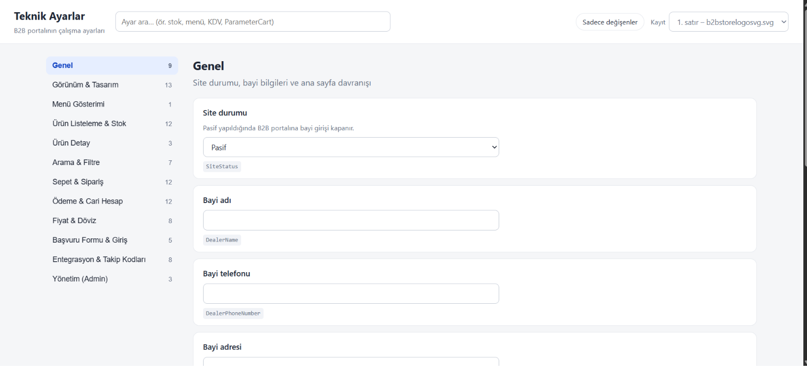
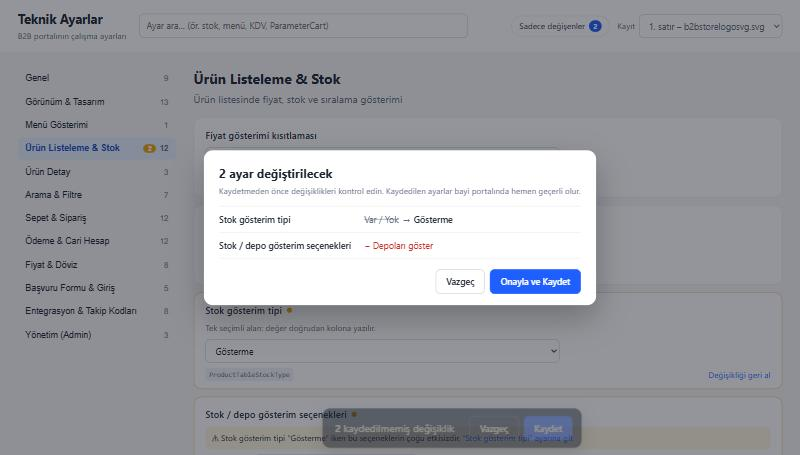

# B2B Store – Teknik Ayarlar Modülü

B2B Store platformundaki **Teknik Ayarlar** ekranının yeniden tasarlanıp geliştirilmiş hâli.
Amaç, teknik bilgisi sınırlı bir müşterinin bile bayi portalının ayarlarını kolayca anlayıp yönetebilmesi.

Mevcut `DealerSettings` tablosunun yapısı, parametrelerin anlamları ve veri karşılıkları **korunmuştur**; veritabanı şemasında değişiklik yapılmamıştır.


> 🔗 **Canlı demo:** https://b2b-teknik-ayarlar.runasp.net · 🎬 **Ekran kaydı:** https://www.youtube.com/watch?v=EMRM-J4qoek



---

## İçindekiler

- [Özellikler](#özellikler)
- [Eski ekrana göre farklar](#eski-ekrana-göre-farklar)
- [Mimari](#mimari)
- [Kurulum ve çalıştırma](#kurulum-ve-çalıştırma)
- [API](#api)
- [Güvenlik: SQL injection'a karşı iki katman](#güvenlik-sql-injectiona-karşı-iki-katman)
- [Bitwise parametreler nasıl kaydediliyor?](#bitwise-parametreler-nasıl-kaydediliyor)
- [Testler](#testler)
- [Proje yapısı](#proje-yapısı)
- [Bilinen sınırlamalar](#bilinen-sınırlamalar)

---

## Özellikler

- **93 parametre, 12 anlaşılır kategori**: Genel, Görünüm & Tasarım, Menü, Ürün Listeleme & Stok, Ürün Detay, Arama & Filtre, Sepet & Sipariş, Ödeme & Cari, Fiyat & Döviz, Başvuru Formu, Entegrasyon, Admin
- **Arama**: ayar adı, açıklama, seçenek ve kolon adında arama; **"sadece değişenler"** filtresi
- **Her ayara uygun bileşen**: açık/kapalı anahtarlar, açılır listeler, çoklu seçim (bitwise), sayı, metin, renk
- **Açıklama metinleri** ve **ilişkili ayar uyarıları** ("Bu ayar şuna bağlı → ilgili ayara git")
- **Kaydetmeden önce değişiklik özeti**: eski → yeni değer; bitwise ayarlarda eklenen ve kaldırılan seçenekler
- **Sadece değişenler gönderilir**: bitwise ayarlarda yalnızca değişen bitler gider, diğer bitler korunur
- **Sunucu tarafı doğrulama**: katalogda tanımlı 5 kural (beyaz liste, bitwise, seçenek, açık/kapalı, uzunluk ve sayı); hatalar standart ProblemDetails (RFC 7807) biçiminde döner
- Değişiklik işaretleri, tek tek geri alma, `Ctrl + S`, mobil uyumlu yerleşim



## Eski ekrana göre farklar

| Eski ekran | Yeni ekran |
|---|---|
| ~95 ayar tek sayfada | 12 kategori + arama |
| Açıklama yok, ters mantıklı değerler ("1 = Hayır") | Anlaşılır başlıklar, yardım metinleri, açık/kapalı anahtarlar |
| Neyin değiştiği görünmüyor | Değişen ayarlar işaretli, geri alınabilir, kayıttan önce özet |
| Bütün form gönderiliyor | Sadece değişen ayarlar ve bitler gönderiliyor |
| Veritabanı kolonuna sığmayan seçenekler seçilebiliyor | Bu seçenekler devre dışı ve uyarılı; API de reddediyor |

## Mimari

```
frontend/                          Vue 3 + TypeScript + Vite
   │  fetch /api/settings
   ▼
backend/B2BStore.Settings.Api      .NET 11 Web API
   ├─ Controllers/    HTTP katmanı: isteği alır, Service'i çağırır, 200 / 400 / 404 döner
   ├─ Services/       iş kuralları: katalogla doğrulama, kaydetme akışı, değişenleri bulma
   ├─ Repositories/   SQL (Dapper): okuma ve tek UPDATE ile kaydetme
   ├─ Dtos/           frontend ile API arasındaki JSON şekilleri
   └─ Catalog/        settings-catalog.json: 93 ayarın tanımı
   ▼
SQL Server 2022 – dbo.DealerSettings
```

Katmanlar tek yönlü konuşur: **Controller → Service → Repository**. Controller veritabanını, Repository iş kurallarını bilmez. Bağımlılıklar `Program.cs`'te kaydedilir; katalog **Singleton** (uygulama açılırken bir kez yüklenir), Repository ve Service **Scoped** (her HTTP isteğinde yeni).

**Neden Dapper?** `DealerSettings` tablosunda birincil anahtar yok ve her kayıtta farklı kolonlar güncelleniyor. EF Core anahtarsız bir tabloyu güncelleyemez; Dapper ile SQL'i kendimiz yazıp sonucu C# nesnelerine çeviriyoruz.

Ekran **katalog tabanlı** çalışır: `settings-catalog.json` her ayarın grubunu, etiketini, kolonunu, SQL tipini, kontrol tipini, seçeneklerini ve bit değerlerini tanımlar. Aynı katalog frontend'de **neyin çizileceğini**, backend'de **neyin kabul edileceğini** belirler. Kontroller ayarın türüne göre yazıldığı için kataloğa yeni bir ayar eklemek kod değişikliği gerektirmez.

## Kurulum ve çalıştırma

### Gereksinimler

- [.NET SDK 11](https://dotnet.microsoft.com/download)
- [Node.js 20+](https://nodejs.org/)
- [Docker Desktop](https://www.docker.com/products/docker-desktop/) (SQL Server için) ve SSMS

### 1. Veritabanı

Proje ana klasöründe bir `.env` dosyası oluşturun:

```env
SA_PASSWORD=<güçlü-bir-şifre>
```

SQL Server'ı başlatın:

```powershell
docker compose up -d
```

`store5.bak` dosyasını `backup/` klasörüne koyup SSMS'te geri yükleyin:

```sql
RESTORE DATABASE store5
FROM DISK = N'/var/opt/mssql/backup/store5.bak'
WITH MOVE N'store5'     TO N'/var/opt/mssql/data/store5.mdf',
     MOVE N'store5_log' TO N'/var/opt/mssql/data/store5_log.ldf',
     REPLACE;
```

> Yedek dosyası, `.env` ve bağlantı bilgileri repoya dahil değildir.

### 2. Backend

`backend/B2BStore.Settings.Api/appsettings.Development.json` dosyasını oluşturun:

```json
{
  "ConnectionStrings": {
    "Store": "Server=localhost,1433;Database=store5;User Id=sa;Password=<şifre>;TrustServerCertificate=True;"
  }
}
```

```powershell
cd backend/B2BStore.Settings.Api
dotnet run
```

- API: `http://localhost:5080`
- OpenAPI dokümanı (geliştirme modunda): `http://localhost:5080/openapi/v1.json`

Visual Studio ile: `B2BStore.TechnicalSettings.slnx` → profil **http** → **F5**

### 3. Frontend

```powershell
cd frontend
npm install
npm run dev
```

Uygulama: `http://localhost:5173` (`/api` istekleri otomatik olarak `localhost:5080`'e yönlendirilir).

### Tek servis olarak yayın

```powershell
cd frontend
npm run build                      # çıktı: backend/B2BStore.Settings.Api/wwwroot
cd ../backend/B2BStore.Settings.Api
dotnet publish -c Release
```

API, derlenmiş Vue uygulamasını `wwwroot` klasöründen kendisi sunar. Canlı ortamın bağlantı bilgisi `appsettings.Production.json` dosyasındadır (repoya dahil değildir).

## API

| Metot | Adres | Açıklama |
|---|---|---|
| `GET` | `/api/settings/catalog` | Ayar tanımları (ekran bu katalogdan oluşur) |
| `GET` | `/api/settings/rows` | DealerSettings satırlarının kısa özeti (satır no, logo, renk, bayi adı) |
| `GET` | `/api/settings?row=1` | Seçili satırın değerleri |
| `PUT` | `/api/settings?row=1` | Değişiklikleri kaydeder |

Satırlar **1'den** numaralanır (1. satır = `row=1`).

Örnek kayıt isteği:

```json
{
  "changes": [
    { "key": "SiteStatus", "value": "1" },
    { "key": "ParameterMenu", "setBits": "0", "clearBits": "1" }
  ]
}
```

Cevap, gerçekten değişen ayarları ve kayıttan sonraki güncel değerleri içerir:

```json
{
  "changedKeys": ["SiteStatus", "ParameterMenu"],
  "settings": { "row": 1, "values": { "SiteStatus": "1", "ParameterMenu": "...", "...": "..." } }
}
```

Hatalı istekte ProblemDetails döner:

```json
{
  "title": "Geçersiz istek",
  "status": 400,
  "detail": "SiteStatus: geçersiz seçenek '5'"
}
```

| Durum | Kod |
|---|---|
| Kurallardan biri geçilemedi (bilinmeyen ayar, geçersiz seçenek, bilinmeyen bit, çok uzun metin…) | **400** |
| Olmayan bir satır istendi (`row=10`) | **404** |

## Güvenlik: SQL injection'a karşı iki katman

1. **Değerler her zaman parametreyle gider.** SQL metninde yalnızca `@deger0` gibi yer tutucular bulunur; kullanıcının yazdığı değer SQL metnine hiçbir zaman eklenmez. SQL Server önce komutu çözümler, değeri ancak sonra veri olarak yerleştirir.
2. **Kolon adları beyaz listeden geçer.** Kolon adları parametre olamadığı için, gelen her `key` önce katalogda aranır. Katalogda olmayan bir ad (örneğin `Logo; DROP TABLE ...`) Repository'ye hiç ulaşmaz; SQL'e her zaman katalogdaki resmi ad yazılır.

## Bitwise parametreler nasıl kaydediliyor?

`ParameterMenu`, `ParameterProductDetail`, `ParameterStock` gibi kolonlar birden çok açık/kapalı seçeneği tek bir sayıda saklar; her seçenek bir bittir (1, 2, 4, 8 …).

Arayüz değerin tamamını değil, sadece **açılan** (`setBits`) ve **kapatılan** (`clearBits`) bitleri gönderir. API bu farkı tek bir `UPDATE` cümlesinde, veritabanının o anki değerine uygular:

```sql
[ParameterMenu] = ([ParameterMenu] | @ac) & ~@kapat
```

```
örnek:  mevcut 5 (0101)  →  setBits 2, clearBits 4  →  3 (0011)
        dokunulmayan bitler aynen kalır
```

Hesap veritabanında, mevcut değer üzerinde yapıldığı için ekranda gösterilmeyen bitler ve aynı anda başka bir kullanıcının değiştirdiği bitler bozulmaz. Kayıttan önce gönderilen bitlerin katalogdaki **bilinen bitler** içinde olup olmadığı da kontrol edilir; bilinmeyen bir bite dokunan istek reddedilir.

`bigint` değerler 2^53'ten büyük olabildiği için API'de string, arayüzde `BigInt` olarak taşınır (JavaScript `number` bu büyüklükteki tam sayıları doğru tutamaz).

## Testler

Yeni backend yerel veritabanıyla uçtan uca test edildi:

| Test | Sonuç |
|---|---|
| `GET /api/settings/rows` | 4 satır, logolar ve renkler SSMS sonucuyla aynı |
| `GET /api/settings?row=2` | 222 kolonun değerleri |
| `GET /api/settings?row=10` | 404, "10. satır bulunamadı" |
| `GET /api/settings/catalog` | 12 grup, 93 ayar |
| Ekrandan kayıt: Site durumu (select) | Kaydedildi; sadece seçilen satır değişti |
| Ekrandan kayıt: Menü gösterimi (63 bitlik bitwise) | Sadece değişen bit gönderildi (`clearBits: "1"`), diğer 10 seçim korundu |

Testler sırasında bulunup düzeltilen iki hata:
- `bit` kolonları `"True"`/`"False"` olarak dönüyordu; arayüz ve doğrulama `"1"`/`"0"` bekliyor. Okuma sırasında dönüştürülüyor.
- Satır numaraları 0'dan başlıyordu, arayüz 1'den bekliyor. 1. satır seçilemiyordu; numaralandırma 1'den başlatıldı.

Ayrıntılar ve ekran görüntüleri Test ve Hata Raporu'ndadır.

## Proje yapısı

```
├─ backend/
│  └─ B2BStore.Settings.Api/
│     ├─ Controllers/    SettingsController
│     ├─ Services/       SettingsService (doğrulama + kaydetme akışı)
│     ├─ Repositories/   SettingsRepository (Dapper + SQL)
│     ├─ Dtos/           istek ve cevap şekilleri
│     └─ Catalog/        SettingsCatalog + settings-catalog.json
├─ frontend/                              Vue 3 + TypeScript
│  └─ src/
│     ├─ api/            API istemcisi ve tipler
│     ├─ composables/    useSettings: durum, değişiklik takibi, BigInt bitwise
│     └─ components/     SettingField, BitmaskField, ChangeSummaryDialog, ToggleSwitch
├─ tools/build_catalog.py                 ayar kataloğu üretici + doğrulama
├─ SQL-Sorguları/                         analizde kullanılan sorgular
├─ docs/screenshots/
└─ docker-compose.yml                     SQL Server 2022
```

## Bilinen sınırlamalar

- API'de kimlik doğrulama yok (demo): adresi bilen herkes ayar değiştirebilir. Gerçek sistemde panelin oturumu ve rolü kontrol edilmelidir.
- `DealerSettings` tablosunda birincil anahtar yoktur. Satırlar fiziksel konumlarına göre sıralanıp numaralanır (`ROW_NUMBER() OVER (ORDER BY %%physloc%%)`); güncelleme tam olarak 1 satırı etkilemezse hata döner. Kalıcı çözüm olarak tabloya bir anahtar kolon eklenmesi önerilir.
- Tabloda 4 satır var ve hangi satırın hangi siteye ait olduğunu söyleyen bir kolon yok. Logolar ve renkler farklı olduğu için satırlar farklı markalara ait olabilir; bu yüzden ekranda satır seçici var.
- Görsel alanlar (logo, favicon) dosya adı olarak düzenlenir; dosya yükleme bu modülün kapsamında değildir.
- Eski ekranda olup veritabanında karşılığı bulunmayan 4 kontrol (Menü Gösterimi 2, Ürün Detay Parametresi 2 – Oturum Kapalı, WhatsApp Sipariş Bildirimi, Favori İkonu Pozisyonu) yeni ekrana alınmamıştır.

---

Eren Altun · B2B Store İş Başvurusu – Teknik Değerlendirme
